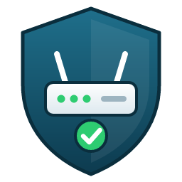

# ioBroker.fb-guard

**Tests:** 

Keeps an eye on the security of your [FRITZ!Box](https://fritz.com) and tells you via Telegram or e-mail when something looks wrong.

[German documentation](docs/de/README.md)

## Why

Whoever gets into the user interface of your box controls your whole home network: port forwardings, DNS, telephony, VPN access. That can happen through a guessed or leaked password, a security hole in the firmware, or a forwarding that was opened long ago and forgotten. The box writes most of this to its event log, but nobody reads it, and it does not warn you.

fb-guard reads it for you. It reports failed and unexpected logins to the box itself (user interface, remote access, apps, TR-064) and, separately, devices that fail to join the Wi-Fi with a wrong key. It also keeps an eye on the settings that make an attack easier.

## What it checks

- **Failed logins** from the event log, grouped per address, with time, user name, access type and whether it came from the internet or your home network
- **Failed Wi-Fi logins** (wrong key), grouped per device, with a hint whether the box already knows the device
- **Logins from the internet** that are not on your list of known addresses
- **Open ports**: port forwardings, MyFRITZ, remote access, FTP over the internet, TR-069 and UPnP. Each port comes with a short explanation of what it is usually used for. Ports you opened on purpose can be confirmed once.
- **Firmware**: update available but not installed, automatic updates off, lab (beta) firmware and newer lab versions
- **Settings**: factory password still active, login without password, two-factor authentication off, new box users, open or weak Wi-Fi encryption, WPS
- **Box restarts** (the event log is cleared on restart)
- A **score from 0 to 100** for your dashboard

The adapter only reads. It never changes anything on the box and only talks to your own box.

## Setup

1. Install the adapter and open the settings. The tabs guide you through it.
2. Create a separate user on the box for the adapter, with only the right "FRITZ!Box Settings" and without internet access.
3. Click "Test connection".
4. Choose Telegram and/or e-mail and send a test message.

All findings are listed in the settings, tab "Findings", each with an explanation. Findings that are intended (for example a port forwarding you set up yourself) can be ticked there and are no longer reported. If anything about them changes, you get notified again. Optionally you get an overview of everything open via Telegram or e-mail, daily or weekly.

## Security and privacy

- The password is stored encrypted in ioBroker and is never written to the log.
- The connection to the box uses TLS. The key of the box certificate is remembered on first use, and the adapter stops logging in if it changes. "Test connection" shows the certificate fingerprint, so you can compare it with the box.
- After a rejected login the adapter stops trying, so it does not lock you out.
- External services are off by default. Right now there is just one: the firmware comparison. It reads the version file from the vendor download server and, for lab firmware, the public lab page on fritz.com. Only the model name is sent.
- The port test only checks your own WAN address.
- Diagnostics mask passwords, keys, user names, addresses and serial numbers.
- Tip: use the ioBroker admin over HTTPS, so your entries are encrypted on the way as well.

No guarantee: this adapter helps you notice problems, it does not make your network secure on its own.

## Disclaimer

FRITZ!, FRITZ!Box, FRITZ!OS and MyFRITZ! are trademarks of FRITZ! GmbH. This project is not affiliated with or endorsed by FRITZ! GmbH (formerly AVM). No guarantee for security, use at your own risk.

## Changelog
<!--
    Placeholder for the next version (at the beginning of the line):
    ### **WORK IN PROGRESS**
-->
### **WORK IN PROGRESS**
* (Flyor) The trusted certificate is bound to the box address and to its key, so a renewed certificate or a new box address no longer raises an alarm
* (Flyor) "Trust certificate again" accepts exactly the certificate from the warning
* (Flyor) Test connection shows the certificate fingerprint and checks the rights more strictly
* (Flyor) Readable adapter title
* (Flyor) Firmware comparison with the vendor server works again with the current file format
* (Flyor) Lab firmware is reported, and newer lab versions are found on the vendor lab page
* (Flyor) README explains what the adapter is for
* (Flyor) Failed Wi-Fi logins (wrong key) are reported per device

### 0.1.1 (2026-10-11)
* (Flyor) Clearer log messages: network problems and internal errors are no longer mixed up
* (Flyor) Pressing "run now" several times no longer queues the same checks again
* (Flyor) Small cleanups in the package

### 0.1.0 (2026-10-11)
* (Flyor) First release: failed logins, open ports, firmware and settings checks, findings and confirmation right in the settings, setup wizard, Telegram and e-mail

## License
MIT License

Copyright (c) 2026 Flyor <AskMe@Stonehiller.de>

Permission is hereby granted, free of charge, to any person obtaining a copy
of this software and associated documentation files (the "Software"), to deal
in the Software without restriction, including without limitation the rights
to use, copy, modify, merge, publish, distribute, sublicense, and/or sell
copies of the Software, and to permit persons to whom the Software is
furnished to do so, subject to the following conditions:

The above copyright notice and this permission notice shall be included in all
copies or substantial portions of the Software.

THE SOFTWARE IS PROVIDED "AS IS", WITHOUT WARRANTY OF ANY KIND, EXPRESS OR
IMPLIED, INCLUDING BUT NOT LIMITED TO THE WARRANTIES OF MERCHANTABILITY,
FITNESS FOR A PARTICULAR PURPOSE AND NONINFRINGEMENT. IN NO EVENT SHALL THE
AUTHORS OR COPYRIGHT HOLDERS BE LIABLE FOR ANY CLAIM, DAMAGES OR OTHER
LIABILITY, WHETHER IN AN ACTION OF CONTRACT, TORT OR OTHERWISE, ARISING FROM,
OUT OF OR IN CONNECTION WITH THE SOFTWARE OR THE USE OR OTHER DEALINGS IN THE
SOFTWARE.
